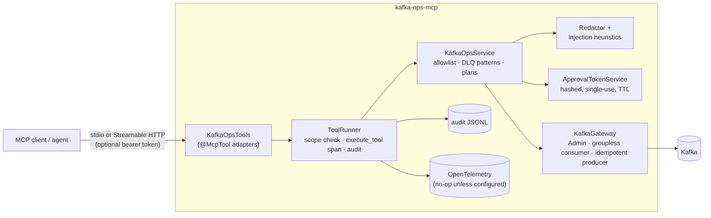
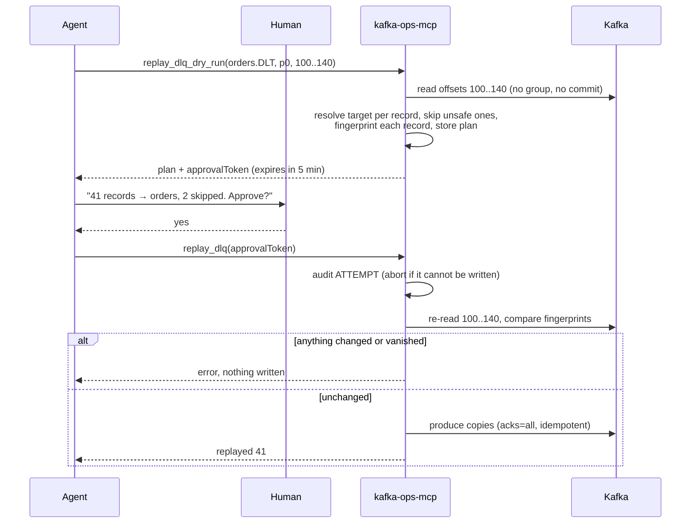

# kafka-ops-mcp

An MCP server that lets an AI agent inspect Kafka and work through a dead-letter queue without being able to
damage anything by accident. It is read-only by default. The one write it supports, replaying DLQ records, needs
a dry run, a plan a human can review, and a short-lived single-use approval token.

Java 21, Spring Boot 4, Spring AI MCP server (official MCP Java SDK underneath), Apache Kafka clients 4.2.

## The problem

When a consumer fails, the record usually ends up in a dead-letter topic: Spring Kafka's
`DeadLetterPublishingRecoverer` writes to `<topic>.DLT`, Kafka Connect writes to whatever
`errors.deadletterqueue.topic.name` says. Apache Kafka itself has no command to look inside that topic, filter
it, or send records back once the bug is fixed. Teams end up with `kafka-console-consumer` one-liners and ad hoc
replay scripts that someone runs against production by hand.

An AI agent is good at the reading part: "why are these 40 orders in the DLQ, and which ones are safe to retry?".
But a lot of Kafka MCP servers hand the agent the whole cluster: produce, delete topics, reset offsets, often with
no auth on the HTTP endpoint. A DLQ also holds exactly the data you least want in a model's context: customer
fields, tokens in headers, and free text written by whoever produced the record, which may include instructions
aimed at the agent.

This server is narrow on purpose. Six tools, scoped, allowlisted, audited, with redaction in front of every byte
that leaves the process.

## Tools

| Tool | Scope | What it does |
| --- | --- | --- |
| `list_topics` | `topics:read` | Allowed topics with partitions and replication factor. Others are counted, not named. |
| `describe_topic` | `topics:read` | Partitions, leader, replicas, ISR, earliest/latest offsets, key configs. |
| `consumer_group_lag` | `groups:read` | Group state, members, lag per partition. Partitions of non-allowed topics are hidden. |
| `browse_dlq` | `dlq:read` | Read recent records or from an offset, with filters. Redacted, flagged, never commits. |
| `replay_dlq_dry_run` | `dlq:read` | Builds a replay plan and, if writes are enabled, returns an approval token. Writes nothing. |
| `replay_dlq` | `dlq:replay` | Executes a plan. Takes only the approval token, nothing else. |

All read tools carry `readOnlyHint=true`; `replay_dlq` carries `destructiveHint=true` so MCP clients that ask the
user before destructive calls will do so.

## Design



Every tool call takes the same path through `ToolRunner`, so a new tool cannot skip its scope check, its span or
its audit line. Kafka and policy logic live in `KafkaOpsService`, which has no MCP dependency and is tested
directly.

### Replay flow



## Safety model

**Read-only unless an operator says otherwise.** `dlq:replay` is the only write scope and is not in the default
scope list. On a read-only instance `replay_dlq` is refused before it looks at the token, and the dry run returns
an informational plan with no token.

**Nothing is visible by default.** `topic-allowlist` is empty out of the box, which denies every topic. Internal
topics (`__consumer_offsets`, `__transaction_state`, ...) are denied even under `*`. DLQ tools additionally require
the topic to match `dlq-topic-patterns`, so a broad allowlist does not let an agent "browse" a business topic.

**Approval tokens.** A dry run stores the plan on the server and returns a random token (`kopr_` + 192 bits).
Only its SHA-256 is kept. The token:
- expires after `replay.token-ttl` (default 5 minutes),
- works once, and is burned on a failed attempt by a different principal,
- is bound to the principal that made the plan,
- is the only argument `replay_dlq` accepts, so offsets and targets cannot be changed after review.

**Replays are conservative.** Each record's target comes from its original-topic header (Spring Kafka's
`kafka_dlt-original-topic`, Kafka Connect's `__connect.errors.topic`, configurable) or an explicit target. Records
are skipped, with a reason, if the target is missing, not allowlisted, internal, or itself a DLQ. At execution
the records are re-read and compared against fingerprints taken at plan time (key, value and headers); if any
changed or were deleted by retention, nothing is written. Replayed copies keep key, value and headers, drop the
DLQ error headers, and gain `kafka-ops-replay-of` and `kafka-ops-replay-plan` for traceability. The DLQ itself is
never modified.

**Redaction before anything leaves.** Applied to keys, payloads, header values, error messages and the audit log:
- headers named like `authorization`, `cookie`, `*token*`, `*secret*`, `*api-key*`, ... are dropped entirely;
- JSON fields are matched on a normalised name, so `cardNumber`, `card_number` and `card-number` all hit
  `*cardnumber*`; defaults cover credentials, card data, bank details, email, phone, date of birth, national ids;
- every remaining string is scanned for JWTs, bearer/basic credentials, AWS access keys, PEM private keys,
  `password=...` style pairs, emails, and 13–19 digit numbers that pass a Luhn check (so order ids survive);
- binary payloads are not decoded, long payloads are truncated after redaction.

Filters in `browse_dlq` run on the redacted text, so `contains="hunter2"` cannot be used to test whether a secret
is present.

**DLQ content is data, not instructions.** Results are JSON with record content in string fields, plus
`contentTrust: "untrusted"` and a notice telling the agent not to follow instructions inside records. A small set
of heuristics flags records that look like prompt injection (`ignore previous instructions`, role overrides,
requests to call tools, mentions of approval tokens, exfiltration requests). The flags are a hint for the agent
and the human reading the transcript; the actual guarantee is structural: no tool executes or interprets content,
and a write needs a token that only a dry run can mint.

**Audit log.** One JSON line per call to `KAFKA_OPS_AUDIT_FILE` (default `./kafka-ops-audit.jsonl`):

```json
{"timestamp":"2026-10-10T17:39:39.49Z","principal":"oncall-agent","client":"example-client/1.0",
 "sessionId":"d113c6a7-...","tool":"replay_dlq","scope":"dlq:replay","args":{"approvalToken":"[REDACTED:field]"},
 "outcome":"OK","reason":null,"summary":"plan 6f0c...: completed, replayed 41","durationMs":212,"traceId":"4bf9..."}
```

Arguments are redacted and results are summarised, not copied, so the audit log is not a second copy of the DLQ.
Writes get a write-ahead `ATTEMPT` line; if that cannot be written, the replay does not run.

**Tracing.** Each call is an `execute_tool {tool}` span (kind `INTERNAL`) following the OpenTelemetry GenAI
semantic conventions: `gen_ai.operation.name=execute_tool`, `gen_ai.tool.name`, `gen_ai.tool.type=function`,
`gen_ai.tool.description`, `error.type` on failure, plus `mcp.method.name` and `mcp.session.id`. Tool arguments
(`gen_ai.tool.call.arguments`, redacted) are opt-in via `kafka-ops.capture-tool-arguments`. The server only
depends on the OpenTelemetry API: without an SDK or the Java agent the spans are no-ops.

**HTTP transport.** Binds to `127.0.0.1` by default. Set `kafka-ops.http.bearer-token-sha256` (the hex SHA-256 of
a token, not the token) to require `Authorization: Bearer <token>`; comparison is constant-time.

## Configuration

Everything lives under `kafka-ops.*`. See [`examples/application-local.yml`](examples/application-local.yml):

```yaml
kafka-ops:
  bootstrap-servers: localhost:9092
  principal: oncall-agent
  scopes: [topics:read, groups:read, dlq:read]     # add dlq:replay to allow replays
  topic-allowlist: ["orders.*", "payments.refunds*"]
  dlq-topic-patterns: ["*.DLT", "*-dlq"]
  replay:
    token-ttl: 5m
    max-messages: 100
  http:
    bearer-token-sha256: ${KAFKA_OPS_BEARER_TOKEN_SHA256:}
```

Kafka client security settings (`security.protocol`, `sasl.*`, `ssl.*`) go under `kafka-ops.client` and are
passed through unchanged.

## Run it

Requires JDK 21.

```bash
mvn -B package
```

**stdio** (Claude Desktop, Cursor, most local clients). Logs go to stderr so stdout stays clean for the protocol:

```bash
java -jar target/kafka-ops-mcp-0.1.0-SNAPSHOT.jar --spring.profiles.active=stdio \
  --kafka-ops.bootstrap-servers=localhost:9092 --kafka-ops.topic-allowlist='orders.*'
```

Client config: [`examples/mcp-client-stdio.json`](examples/mcp-client-stdio.json).

**Streamable HTTP** on `http://127.0.0.1:8080/mcp`:

```bash
export KAFKA_OPS_BEARER_TOKEN_SHA256=$(printf '%s' "$KAFKA_OPS_TOKEN" | sha256sum | cut -d' ' -f1)
java -jar target/kafka-ops-mcp-0.1.0-SNAPSHOT.jar \
  --spring.config.additional-location=examples/application-local.yml
```

Client config: [`examples/mcp-client-http.json`](examples/mcp-client-http.json).

**Traces**: attach the OpenTelemetry Java agent and point it at a collector, e.g.
`java -javaagent:opentelemetry-javaagent.jar -Dotel.service.name=kafka-ops-mcp -jar ...`.

## Tests

```bash
mvn -B verify
```

| Suite | What it covers |
| --- | --- |
| `ToolPolicyTest`, `RedactorTest`, `InjectionHeuristicsTest`, `ApprovalTokenServiceTest` | Scopes, allowlist, globs, redaction rules, Luhn, token expiry/reuse/principal binding |
| `ToolRunnerTest` | Audit outcomes, write-ahead audit, span names and GenAI attributes (in-memory exporter) |
| `EmbeddedKafkaScenariosTest` | 17 end-to-end scenarios on an in-JVM KRaft broker: lag, browse, filters, dry run, replay, skips, stale plans |
| `PromptInjectionTest` | Malicious instructions, JSON breakout, forged tokens and hostile headers planted in DLQ records |
| `McpServerEndToEndTest` | Boots the app and drives it with the official MCP Java client over Streamable HTTP, including bearer auth |
| `ContainerKafkaScenariosTest` | The same 17 scenarios on `apache/kafka:4.2.1` via Testcontainers. Skipped without Docker; CI fails if it was skipped. |

All test data is synthetic.

## How it compares

Checked against each project's README in October 2026. Corrections welcome.

| | Scope of tools | Write controls | DLQ inspect / replay |
| --- | --- | --- | --- |
| [confluentinc/mcp-confluent](https://github.com/confluentinc/mcp-confluent) (TypeScript) | Very broad: Kafka, Flink SQL, Connect, Schema Registry, Tableflow, Confluent Cloud | Per-connection `read_only` flag; HTTP auth with OAuth for Confluent Cloud | No dedicated DLQ tools |
| [tuannvm/kafka-mcp-server](https://github.com/tuannvm/kafka-mcp-server) (Go) | Produce/consume, topics, groups, cluster health | OAuth 2.1 on the HTTP transport; I did not find a read-only mode in its README | No |
| [denizgursoy/kafka-mcp](https://github.com/denizgursoy/kafka-mcp) (Go) | Broad debugging toolset across clusters | Read-only endpoints, per-tool disabling, previews and `confirm` on writes, audit logging | Has message search; no DLQ replay workflow that I found |
| [conduktor/kafka-mcp](https://github.com/conduktor/kafka-mcp) | Ships inside Conduktor Console; fleet-wide ops | Inherits Console RBAC and audit log | Record lookup; part of a commercial product |
| **kafka-ops-mcp** | Six tools, DLQ-focused | Scopes, allowlist, plan + single-use token, write-ahead audit | Yes: redacted browse, fingerprinted plans, guarded replay |

If you want a general Kafka assistant, use one of the first three. This project is for the narrower case where an
agent should help triage and replay a DLQ and you want the write path to be boring and reviewable.

## Limitations

- **Scopes are per server instance, not per user.** Run separate instances (read-only for agents in general, a
  replay-enabled one for on-call) rather than expecting per-caller permissions. The bearer token authenticates
  the client; it does not carry scopes. OAuth 2.1 / per-user identity is not implemented.
- **Approval tokens live in memory.** A restart drops pending approvals (deliberately), and the server is not
  designed to run as several replicas behind a load balancer.
- **The "human approval" step is a protocol, not enforcement.** In the default setup the token goes back to the
  agent; an agent that ignores instructions could call `replay_dlq` without asking. The guarantees are: no replay
  without a dry run, no change between review and execution, no writes on read-only instances. Clients that
  confirm destructive tools (`destructiveHint`) close the gap; delivering the token out-of-band is future work.
- **Replay is not transactional.** Records are sent in order with an idempotent producer and the result reports
  partial progress, but a failure halfway leaves the earlier records replayed.
- **Redaction is pattern matching.** It covers common shapes, not every possible secret or PII format, and does
  not decode Avro/Protobuf (binary payloads are hidden rather than shown). Add your own field names.
- **Injection flags are heuristics** and will miss things. They are not the safety mechanism; the tool design is.
- **Single partition per plan**, up to `replay.max-messages` offsets. Large backfills belong in a proper job.
- Not tested against Confluent Cloud, MSK IAM auth, or clusters with ACLs; client settings pass through, but the
  tests use plaintext brokers.

## License

MIT, see [LICENSE](LICENSE).
